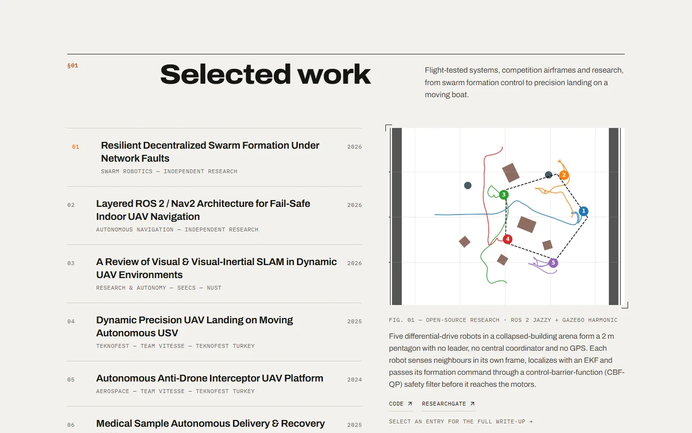
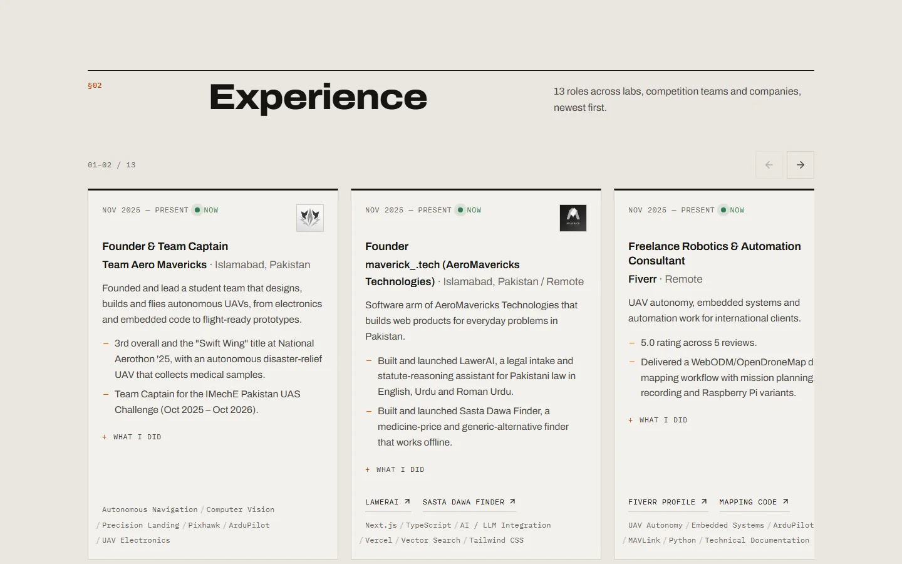
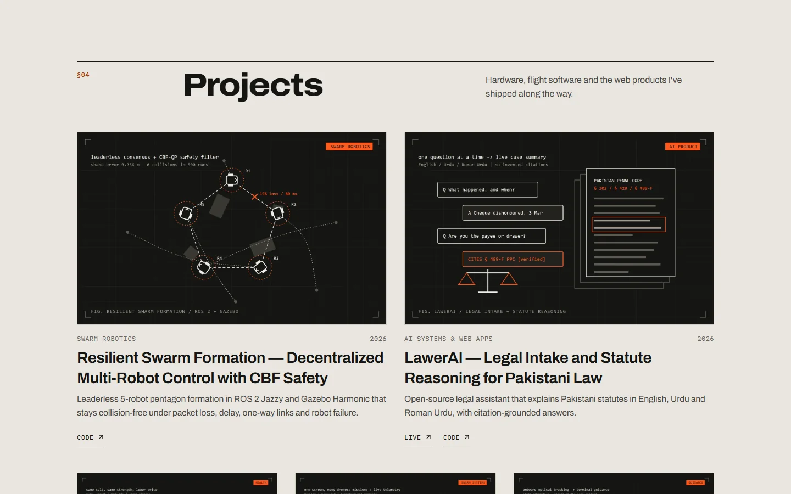
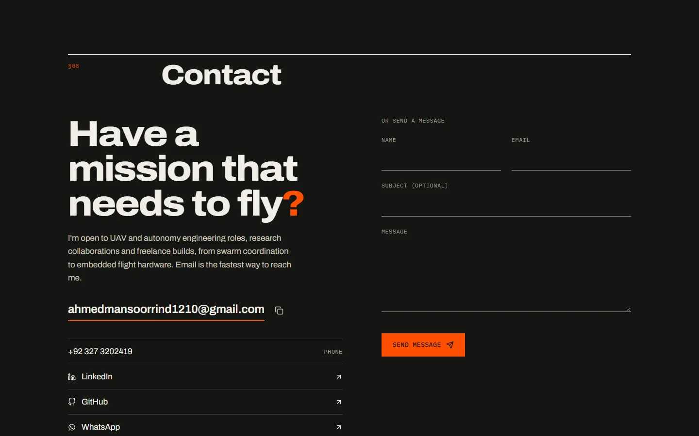

# Mansoor Ahmed Rind — Portfolio

Personal website of **Mansoor Ahmed Rind**, a UAV autonomy and robotics engineer at NUST, Islamabad: selected research and projects, experience, publications, and contact, with a private CMS for editing content.

**Live site:** https://personal-portfolio-swart-sigma-44.vercel.app  
**Demo video:** [docs/demo.mp4](docs/demo.mp4) (30-second walkthrough of the whole site)

<p>
  
  
</p>

## Features

- **Editorial design:** a "flight test report" look with warm paper and ink, one aviation-orange accent, and a real dark mode. Mobile-first with no horizontal scroll.
- **Selected work:** numbered index with a live image preview; each entry opens a side panel with highlights, stack and links (code, papers, demos).
- **Experience slider:** every role in a swipeable, keyboard-friendly slider with a range counter.
- **Research:** citation-style list with links to papers, code, Google Scholar, ResearchGate and ORCID.
- **Projects:** a generated technical illustration for each project, with code and live links.
- **Live details:** Islamabad local time ticking in the hero, availability status, résumé download, WhatsApp and email links.
- **Private CMS:** a separate admin app at a secret URL, never linked or bundled with the public site.
- **Security-tested backend:** 105 automated attack checks (see [Security](#security)).

<p>
  
  
</p>
<p>
  
  
</p>

## Tech stack

| Layer | Tools |
| --- | --- |
| Frontend | React 19, TypeScript, Vite; plain CSS design system (`src/styles/site.css`); Tailwind v4 for the admin |
| Backend | Express 5, JSON file store, JWT + bcrypt, Helmet, express-rate-limit, Multer |
| Hosting | Vercel (static site + serverless API in `api/index.ts`) |
| Fonts | Archivo, IBM Plex Mono |

## Run locally

```bash
npm install
npm run dev
```

| URL | What |
| --- | --- |
| http://localhost:5173 | Public site |
| http://localhost:5173/admin.html | Admin (first visit shows a local-only setup form) |
| http://localhost:5001 | API |

Production build and self-hosted server:

```bash
npm run build
npm start
```

## Editing content

All content lives in `data/portfolio.json`. Edit it through the local admin (or by hand), then commit and push; Vercel redeploys in about a minute.

Edits made in the admin on Vercel are not permanent, because Vercel's filesystem is temporary. After large content changes, refresh the bundled fallback copy in `src/data/initialData.ts` so the admin's "reset to defaults" matches.

## Admin panel in production

The admin is a separate page (`admin.html`) published only at a secret path. Set these in **Vercel → Settings → Environment Variables**, then redeploy:

| Variable | Purpose |
| --- | --- |
| `ADMIN_PATH` | Secret URL segment, 12–64 lowercase letters, digits or dashes (must not contain words like "admin"). The admin is served at `/<ADMIN_PATH>/`. Unset means no admin is published; `/admin` is always a 404. |
| `ADMIN_USERNAME` | Admin login name |
| `ADMIN_PASSWORD_HASH` | bcrypt hash from `npm run hash-password` |
| `JWT_SECRET` | Long random string for signing sessions |
| `ADMIN_TOKEN_VERSION` | Optional; bump it to sign out every session |

Online first-run setup is disabled in production. See `.env.example` for every option.

## Security

```bash
npm run test:security
```

Runs 105 attack-style checks against throwaway servers: admin takeover, injection (HTML/script, `javascript:` and encoded URL schemes, NoSQL-style operators), prototype pollution, mass assignment, token forgery, SSRF including DNS rebinding, malicious uploads and path traversal.

- No SQL database is used, so SQL injection does not apply.
- Server-rendered HTML escapes all CMS content.
- Uploads must match on extension, MIME type and magic bytes; SVG and double extensions are refused.
- The link-preview fetcher requires login and refuses private or local network addresses.

## Project layout

```text
admin.html                 Admin page entry (moved to the secret path at build time)
index.html                 Public site entry
api/index.ts               Vercel serverless entry for the API
data/portfolio.json        Site content
docs/                      README screenshots and demo video
public/                    CV.pdf, robots.txt, sitemap.xml, favicon
scripts/
  hash-password.ts         Generates ADMIN_PASSWORD_HASH
  place-admin.mjs          Publishes the admin at ADMIN_PATH after the build
server/
  index.ts                 Express app: API routes, security headers, uploads
  auth.ts                  JWT + bcrypt
  security.ts              Escaping, URL checks, SSRF-safe fetch
  ssr.ts                   Server-rendered HTML for crawlers (self-hosted)
  store.ts                 JSON store, env-based admin
src/
  App.tsx                  Public site
  AdminApp.tsx             Admin CMS
  components/public/       Site sections (Hero, Selected work, Experience, ...)
  components/admin/        CMS editors
  styles/site.css          Public design system (see DESIGN.md)
tests/security.test.ts     Security test suite
uploads/                   Images (project illustrations in uploads/projects)
```

More detail: [ARCHITECTURE.md](ARCHITECTURE.md) · [DESIGN.md](DESIGN.md)

## Contact

- Email: ahmedmansoorrind1210@gmail.com
- LinkedIn: [linkedin.com/in/mansoorahmedrind](https://www.linkedin.com/in/mansoorahmedrind)
- GitHub: [github.com/UnknownEng](https://github.com/UnknownEng)

© Mansoor Ahmed Rind. All rights reserved.
